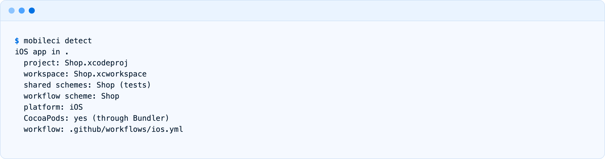
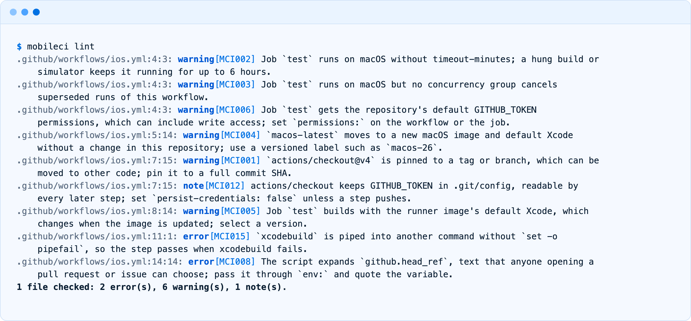
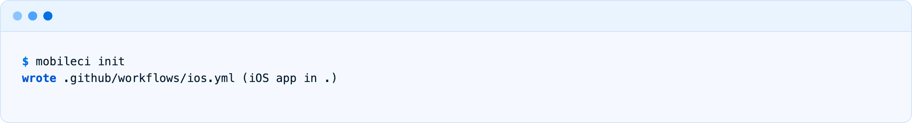
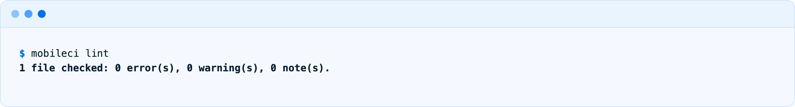
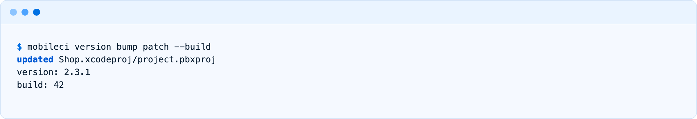
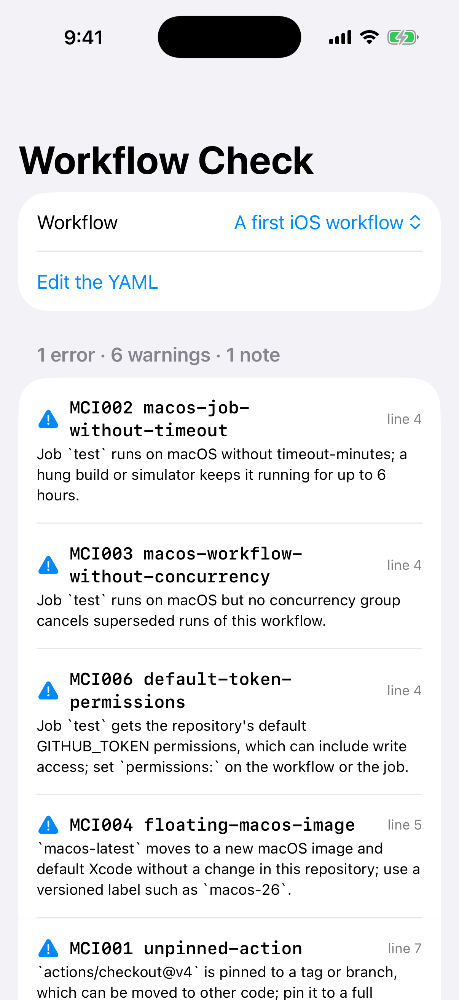
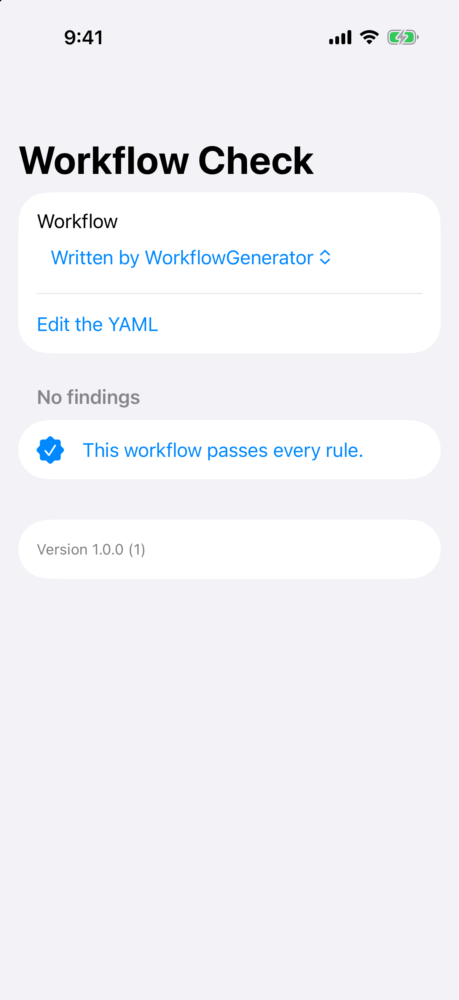
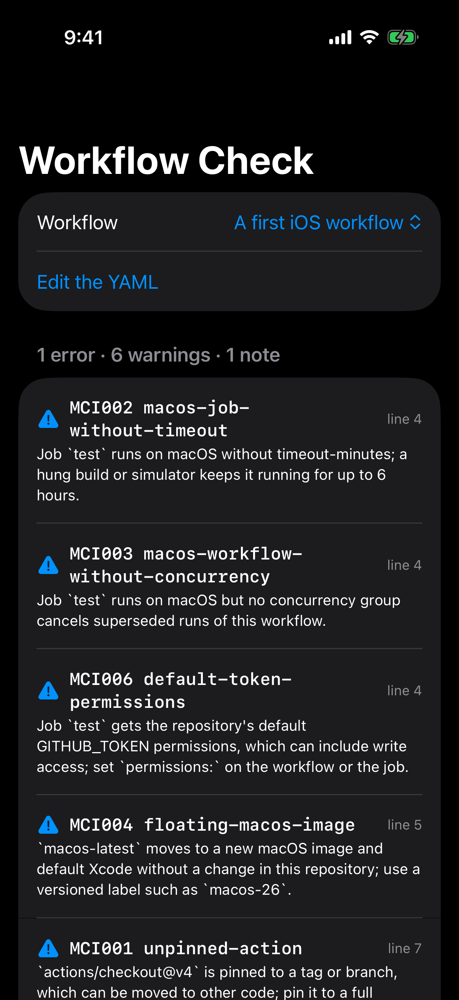
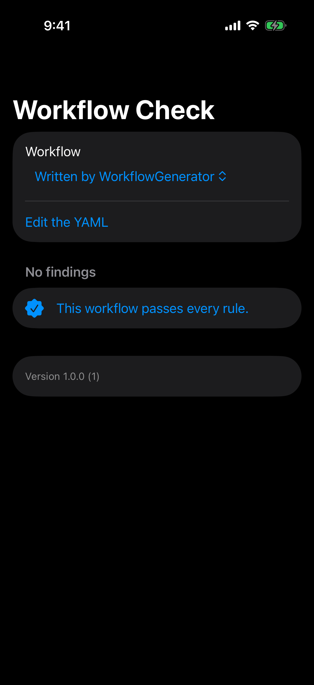

<!-- i18n-source: README.md@ed1511e700d40152eaed4f242aa7d11f82d58650 status=reviewed -->
<!-- brand:start -->

<p align="center"><picture><source media="(prefers-color-scheme: dark)" srcset="https://raw.githubusercontent.com/muhittincamdali/MobileCI/main/.github/brand/banner-dark.svg"><source media="(prefers-color-scheme: light)" srcset="https://raw.githubusercontent.com/muhittincamdali/MobileCI/main/.github/brand/banner-light.svg"></picture></p>

<!-- lang-selector:start -->
<p align="center"><a href="README.md">English</a> · <a href="README.tr.md">Türkçe</a> · <a href="README.zh-CN.md">简体中文</a> · <a href="README.ja.md">日本語</a> · <a href="README.ko.md">한국어</a> · <a href="README.es.md">Español</a> · <a href="README.de.md">Deutsch</a> · <a href="README.fr.md">Français</a> · <a href="README.pt-BR.md">Português (Brasil)</a> · <a href="README.ru.md">Русский</a></p>
<!-- lang-selector:end -->

<p align="center">
<a href="https://github.com/muhittincamdali/MobileCI/actions/workflows/ci.yml"></a>
<a href="https://github.com/muhittincamdali/MobileCI/releases"><picture><source media="(prefers-color-scheme: dark)" srcset="https://raw.githubusercontent.com/muhittincamdali/MobileCI/main/.github/brand/badge-version-dark.svg"><source media="(prefers-color-scheme: light)" srcset="https://raw.githubusercontent.com/muhittincamdali/MobileCI/main/.github/brand/badge-version-light.svg"></picture></a>
<a href="https://github.com/muhittincamdali/MobileCI/blob/main/Package.swift"><picture><source media="(prefers-color-scheme: dark)" srcset="https://raw.githubusercontent.com/muhittincamdali/MobileCI/main/.github/brand/badge-platforms-dark.svg"><source media="(prefers-color-scheme: light)" srcset="https://raw.githubusercontent.com/muhittincamdali/MobileCI/main/.github/brand/badge-platforms-light.svg"></picture></a>
<a href="https://github.com/muhittincamdali/MobileCI/blob/main/Package.swift"><picture><source media="(prefers-color-scheme: dark)" srcset="https://raw.githubusercontent.com/muhittincamdali/MobileCI/main/.github/brand/badge-language-dark.svg"><source media="(prefers-color-scheme: light)" srcset="https://raw.githubusercontent.com/muhittincamdali/MobileCI/main/.github/brand/badge-language-light.svg"></picture></a>
<a href="https://github.com/muhittincamdali/MobileCI/blob/main/LICENSE"><picture><source media="(prefers-color-scheme: dark)" srcset="https://raw.githubusercontent.com/muhittincamdali/MobileCI/main/.github/brand/badge-license-dark.svg"><source media="(prefers-color-scheme: light)" srcset="https://raw.githubusercontent.com/muhittincamdali/MobileCI/main/.github/brand/badge-license-light.svg"></picture></a>
</p>

<p align="center">
<a href="#快速开始"><picture><source media="(prefers-color-scheme: dark)" srcset="https://raw.githubusercontent.com/muhittincamdali/MobileCI/main/.github/brand/button-start-zh-CN-dark.svg"><source media="(prefers-color-scheme: light)" srcset="https://raw.githubusercontent.com/muhittincamdali/MobileCI/main/.github/brand/button-start-zh-CN-light.svg"></picture></a>
<a href="https://muhittincamdali.github.io/MobileCI/documentation/mobilecikit/"><picture><source media="(prefers-color-scheme: dark)" srcset="https://raw.githubusercontent.com/muhittincamdali/MobileCI/main/.github/brand/button-docs-zh-CN-dark.svg"><source media="(prefers-color-scheme: light)" srcset="https://raw.githubusercontent.com/muhittincamdali/MobileCI/main/.github/brand/button-docs-zh-CN-light.svg"></picture></a>
<a href="https://github.com/muhittincamdali/MobileCI/tree/main/Examples"><picture><source media="(prefers-color-scheme: dark)" srcset="https://raw.githubusercontent.com/muhittincamdali/MobileCI/main/.github/brand/button-examples-zh-CN-dark.svg"><source media="(prefers-color-scheme: light)" srcset="https://raw.githubusercontent.com/muhittincamdali/MobileCI/main/.github/brand/button-examples-zh-CN-light.svg"></picture></a>
</p>

> 本文是英文 README 的译文。如两者内容不一致，以英文版为准。

<!-- brand:end -->

MobileCI 是一个命令行工具、一个 GitHub Action 和一个 Swift 库，用于 iOS、Flutter 和 React Native 应用的 CI。它会读取你的仓库，生成一个 GitHub Actions workflow，在当前的 runner 镜像上构建并测试每个应用；检查现有 workflow 中会让移动端 CI 变慢、变贵或不安全的问题；并让应用的版本号和构建号在 Xcode、Flutter、Gradle 和 Expo 文件之间保持同步。它面向希望获得一条可用流水线、又不想先弄懂每个 runner 细节的应用开发者。

## 亮点

- **检测 CI 将看到的内容** — Xcode 项目及其共享 scheme、CocoaPods 与 Swift package 的使用情况、Flutter 平台文件夹、React Native 或 Expo 应用所用的包管理器，以及首次运行时容易遇到的问题，例如未共享的 scheme。
- **生成最新且已固定版本的 workflow** — 每个 action 都固定到其发布 commit，使用 `macos-26` 并选择 Xcode 26.6，权限为 `contents: read`，并配置超时、缓存，以及取消被取代的运行；每个生成的文件都能通过本工具自带的 lint 和 actionlint。
- **16 条移动端 workflow lint 规则** — `macos-latest` 漂移、缺少 Xcode 选择、被 `| xcbeautify` 掩盖的测试失败、缺少超时、未固定的 action、通过 pull request 标题进行的脚本注入，以及 `pull_request_target` checkout；输出支持文本、JSON、GitHub annotation 和 SARIF 格式。
- **一条版本命令** — `mobileci version bump patch --build` 会同时更新 `MARKETING_VERSION`、`pubspec.yaml`、`package.json`、`app.json` 和 `build.gradle`，并且会拒绝超过 Google Play 上限的构建号，而不是让它溢出。
- **对不受信任的仓库也安全** — 读取文件时有大小限制，YAML 别名和嵌套层数有上限，`detect` 不会进入符号链接指向的文件夹，消息从不引用文件内容，annotation 输出也无法注入 workflow 命令。
- **经过测试并自用验证** — 129 个 Swift Testing 测试在 macOS 和 iPhone 模拟器上运行；本仓库示例中的 iOS 和 Flutter workflow 由 `mobileci init` 生成，一旦它们与生成器的输出不一致，就会有一个 CI 任务失败。

## 快速开始

**1. 安装工具**

```sh
git clone https://github.com/muhittincamdali/MobileCI.git
cd MobileCI
swift build --configuration release --product mobileci
sudo install .build/release/mobileci /usr/local/bin/mobileci
```

**2. 为你的应用生成 workflow**

在你的应用仓库根目录下：

```sh
mobileci detect   # what CI will see
mobileci init     # writes .github/workflows/ios.yml, flutter.yml or react-native.yml
```

**3. 检查并推送**

```sh
mobileci lint
git add .github/workflows && git commit -m "ci: build and test on GitHub Actions" && git push
```

## 安装

### 命令行工具

按快速开始中的方式从源码构建，得到的是一个单独的可执行文件。它可在 macOS 14 或更高版本上运行，也可在装有 Swift 6.2 或更高版本的 Linux 上运行。

### GitHub Action

该 action 会在 runner 上构建本工具并检查仓库中的 workflow；发现的问题会以 annotation 的形式显示在 pull request 上：

```yaml
jobs:
  workflows:
    runs-on: ubuntu-24.04
    timeout-minutes: 15
    permissions:
      contents: read
    steps:
      - uses: actions/checkout@3d3c42e5aac5ba805825da76410c181273ba90b1 # v7.0.1
        with:
          persist-credentials: false
      - uses: muhittincamdali/MobileCI@main # pin to a release commit, as MCI001 asks
        with:
          fail-on: warning
```

输入参数：`paths`、`format`（`github`、`text`、`json`、`sarif`）、`fail-on`、`disable` 和 `output`（见 [action.yml](action.yml)）。

### Swift package

在 Xcode 中选择 **File › Add Package Dependencies…**，然后输入仓库地址：

```text
https://github.com/muhittincamdali/MobileCI.git
```

或者将其添加到 `Package.swift` 的 `dependencies` 中：

```swift
dependencies: [
    .package(url: "https://github.com/muhittincamdali/MobileCI.git", branch: "main")
],
targets: [
    .target(name: "YourTool", dependencies: [
        .product(name: "MobileCIKit", package: "MobileCI")
    ])
]
```

## 使用方法

### 查看 CI 将看到的内容

`mobileci detect` 会列出每个项目以及 workflow 用到的细节，并指出应当先修复什么：



### 检查现有 workflow

`mobileci lint` 会检查 `.github/workflows` 中的每个文件，当某条发现达到 `--fail-on` 级别（默认为 warning）时，以状态码 1 退出。许多应用最初的 workflow 就是下面这样：



`mobileci rules` 会列出每条规则及其修复方法；[规则参考](https://muhittincamdali.github.io/MobileCI/documentation/mobilecikit/lintrules)解释了每条规则为何重要。在不适用的地方，可以用位于该行或上一行的注释来屏蔽某条规则：

```yaml
- uses: actions/checkout@3d3c42e5aac5ba805825da76410c181273ba90b1 # v7.0.1
  # mobileci-ignore MCI012: the release job pushes the version tag with this token
```

### 生成 workflow

`mobileci init` 为每个项目写入一个文件；`--stdout` 改为直接打印，`--xcode 26.4.1`、`--simulator "iPhone 17 Pro"` 或 `--scheme` 等选项可以修改相应的值：



生成的 workflow 能通过所有规则：



[Templates](Templates) 文件夹里放着每种类型示例项目的输出：[iOS 应用](Templates/ios.yml)、[使用 CocoaPods 的 iOS 应用](Templates/ios-cocoapods.yml)、[macOS 应用](Templates/macos.yml)、[Swift package](Templates/swift-package.yml)、[Flutter 应用](Templates/flutter.yml)、[React Native 应用](Templates/react-native.yml)和 [Expo 应用](Templates/expo.yml)。如果你不想安装本工具，可以直接复制其中一个。

### 提升版本号



`mobileci version` 会列出它找到的所有版本号和构建号；`bump`、`set` 和 `build` 会一次性修改所有文件，`--dry-run` 则只显示结果而不写入。

### 在 Swift 中调用 lint

[示例应用](Examples/WorkflowCheck/WorkflowCheck/CheckModel.swift)通过下面这个调用在 iPhone 上检查 workflow：

```swift
static func check(_ text: String) -> [Finding] {
    WorkflowLinter().lint(text: text, path: "workflow.yml")
}
```

并展示 `mobileci init` 会为它生成的 workflow（[Samples.swift](Examples/WorkflowCheck/WorkflowCheck/Samples.swift)）：

```swift
let project = DetectedProject(directory: ".", kind: .xcode(XcodeProject(
    projectFile: "WorkflowCheck.xcodeproj",
    workspaceFile: nil,
    schemes: [XcodeScheme(name: "WorkflowCheck", hasTests: true)],
    platform: .iOS,
    usesCocoaPods: false,
    usesBundler: false,
    usesSwiftPackages: false
)))
return try WorkflowGenerator().workflow(for: project).contents
```

## 演示

示例应用在 iPhone 模拟器上用 MobileCIKit 检查示例 workflow，截图由 [`scripts/capture-example-screens.sh`](scripts/capture-example-screens.sh) 生成：

| 初版 iOS workflow                                                   | 由 `WorkflowGenerator` 生成                                       |
| ------------------------------------------------------------------- | ----------------------------------------------------------------- |
|  |  |
|   |   |

“使用方法”一节中的终端图片，是本工具在示例仓库上的真实运行结果，由 [`scripts/capture-terminal.sh`](scripts/capture-terminal.sh) 渲染（深色版本位于 [docs/images](docs/images)）。

要运行该应用，请用 Xcode 打开 [Examples/WorkflowCheck](Examples/WorkflowCheck) 中的 `WorkflowCheck.xcodeproj`，选择一个 iPhone 模拟器，然后点击 **Run**。[Examples/README.md](Examples/README.md) 也介绍了 Flutter 示例。

## 文档

API 参考文档与文章：

- [MobileCIKit 参考](https://muhittincamdali.github.io/MobileCI/documentation/mobilecikit/)
- [Lint 规则](https://muhittincamdali.github.io/MobileCI/documentation/mobilecikit/lintrules)
- [限制与安全](https://muhittincamdali.github.io/MobileCI/documentation/mobilecikit/limitsandsafety)

## 指南

- [入门](https://muhittincamdali.github.io/MobileCI/documentation/mobilecikit/gettingstarted) — 安装、detect、init、lint 和 version，一步一步来。
- [生成 workflow](https://muhittincamdali.github.io/MobileCI/documentation/mobilecikit/generatingworkflows) — 每个生成的 job 做什么，以及全部选项。
- [版本管理](https://muhittincamdali.github.io/MobileCI/documentation/mobilecikit/versionmanagement) — 涉及的文件、规则和限制。

## 系统要求

| 平台              | 最低版本                |
| ----------------- | ----------------------- |
| macOS（工具和库） | 14                      |
| iOS（库）         | 17                      |
| Linux（工具和库） | Swift 6.2 工具链        |
| 工具链            | Swift 6.2+（Xcode 26+） |

生成的 workflow 面向 GitHub 的 `macos-26`（Xcode 26.6）和 `ubuntu-24.04` runner；每个值都可以通过选项修改。

## 架构

- `Sources/MobileCIKit/Detection` — `ProjectDetector` 遍历仓库（3 层，不进入符号链接指向的文件夹），并将 `.xcodeproj` 包、`pubspec.yaml`、`package.json` 和 `Package.swift` 作为文本读取。
- `Sources/MobileCIKit/Generation` — `WorkflowGenerator` 根据经过验证的值逐行写出 YAML；`PinnedAction` 保存各 action 的 commit。
- `Sources/MobileCIKit/Lint` — `YAMLValue` 保留每个节点的位置（使用 [Yams](https://github.com/jpsim/Yams) 在大栈线程上解析，并设有节点数和深度限制），`Workflow` 暴露 job 和 step，每条规则对应一个函数来报告 `Finding`。
- `Sources/MobileCIKit/Reporting` — 文本、JSON、GitHub annotation 和 SARIF 输出。
- `Sources/MobileCIKit/Versioning` — `VersionFile` 定位版本字段并原地替换；`VersionManager` 规划并应用跨文件的变更。
- `Sources/mobileci` — 命令行界面（[swift-argument-parser](https://github.com/apple/swift-argument-parser)）。

[`scripts/generate-workflows.sh`](scripts/generate-workflows.sh) 会重新生成 `Templates/` 和示例 workflow；加上 `--check` 时，若它们与生成器的输出不一致就会失败。

## 路线图

- 在发布版本中附带预构建的二进制文件，这样 action 就不必每次运行都编译本工具。
- 检测原生 Android 项目（不含 React Native 或 Flutter 的 Gradle）。
- 增加一条规则，检查所选 runner 镜像上不存在的模拟器目标。

## 参与贡献

欢迎参与贡献。提交 pull request 之前，请先阅读[贡献指南](CONTRIBUTING.md)和[行为准则](https://github.com/muhittincamdali/.github/blob/main/CODE_OF_CONDUCT.md)。如发现安全问题，请按照[安全策略](SECURITY.md)私下报告。

## 许可证

基于 MIT 许可证发布。详见 [LICENSE](LICENSE)。
